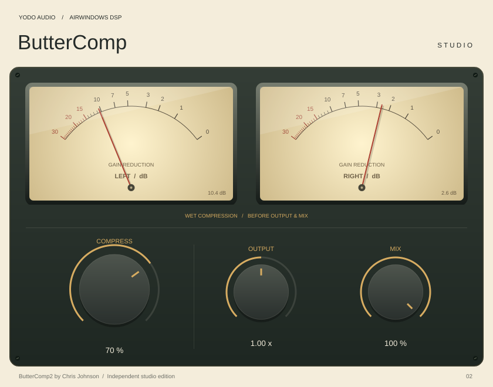

# ButterComp Studio

An independent VST3 adaptation of **Airwindows ButterComp2**, with a native cream,
charcoal and brass editor. For Apple Silicon Macs, including M2 and later.



Three main controls retain ButterComp2's original ranges and defaults:

| Control | Range | Default |
| --- | --- | --- |
| Compress | 0–100% | 0% |
| Output | 0–2× linear gain | 1× |
| Mix | 0–100% wet | 100% |

Includes two illuminated analogue gain-reduction meters, editable numeric values, double-click reset,
32/64-bit audio processing and host session state recall. Stereo input/output only.
Meters display the wet compressor gain element in dB, before output gain and
parallel mix, with independent left/right needles and a 0-30 dB scale.
The compressor is active internally even at 0% mix, so the meters still show wet-path
reduction. Input drive and automatic gain compensation are excluded from this
reading. A 12 ms attack and 280 ms release give the needles analogue-style motion;
needles return to rest during silence, host bypass and stopped processing.
Readings above 30 dB pin the needles at the end of the scale. The original DSP is not a limiter;
output can exceed 0 dBFS. No extra attack, release or threshold controls are invented.
This plugin has its own identity and does not replace existing Airwindows instances.

## Build, sign, and install on your Mac

Install Xcode Command Line Tools (`xcode-select --install`) and CMake 3.22+
(`brew install cmake`), close your DAW, then run from the repository:

```sh
bash scripts/build-sign-install-mac.sh
```

This one command builds and tests the Apple Silicon VST3, ad-hoc signs a staged
copy, verifies its signature, and installs it to:

`~/Library/Audio/Plug-Ins/VST3/ButterComp Studio.vst3`

An existing installation is replaced only after the new copy passes signing and
verification. If replacement fails, the script attempts to restore the previous
installation. The source bundle is left unchanged. Restart or rescan plugins in
your VST3 DAW afterwards.

To sign and install an already downloaded/extracted bundle without compiling:

```sh
bash scripts/build-sign-install-mac.sh --install-only "/path/to/ButterComp Studio.vst3"
```

The script targets arm64 (including M2 and later) and macOS 11+, uses no `sudo`,
and follows the workflow from [GuitarSim](https://github.com/johandoornenbal/guitarsim).
Run it in a native Apple Silicon terminal with Rosetta disabled. The bundle is
ad-hoc signed, not notarized. Logic Pro requires an Audio Unit and cannot load
this VST3 target.

Optional `BUTTERCOMP_BUILD_DIR` and `BUTTERCOMP_INSTALL_DIR` environment variables
override the build and installation folders. Extra CMake configure arguments are
passed through, for example:

```sh
bash scripts/build-sign-install-mac.sh -DJUCE_PATH=/absolute/path/to/JUCE
```

The first configure downloads pinned JUCE 8.0.12 unless an existing checkout is
provided. The default build output is:

`build-mac/ButterCompStudio_artefacts/Release/VST3/ButterComp Studio.vst3`

For command-line options, run `bash scripts/build-sign-install-mac.sh --help`.
GitHub Actions also builds, tests, ad-hoc signs, and archives the arm64 VST3.
Actual macOS compilation, signing, and DAW playback require verification on a Mac;
Linux script checks do not establish that those steps work.

## Validation

```sh
# DSP-only validation on Linux/macOS, no JUCE or audio device needed
cmake -S . -B build-dsp -DBUTTER_DSP_ONLY=ON -DCMAKE_BUILD_TYPE=Release
cmake --build build-dsp --parallel 2
ctest --test-dir build-dsp --output-on-failure
```

DSP tests exercise multiple sample rates, block sizes, dry mix, output muting,
noise floor, float/double consistency and reset. A separate reference test compiles
the untouched upstream processing source and compares 48 scenarios. A gain-reduction suite checks calibration against rendered audio, channel
independence, output/mix isolation, release behavior and float/double consistency
at four sample rates. The wrapper
check tests session-state recall, stereo processing, both meter components and PNG render.
It writes `ui-preview.png` into its build working directory.

Native Apple Silicon compilation, macOS signing and DAW loading require macOS and
remain separate from Linux verification. Before a release, run the macOS workflow
and test automation, state recall, playback and editor behavior in your DAW.

## License and attribution

ButterComp2 DSP © Chris Johnson / Airwindows, MIT. Original source and license are
in `third_party/airwindows`; provenance and adaptation details are in
[THIRD_PARTY.md](THIRD_PARTY.md). This is not an official Airwindows release.

The wrapper and UI are MIT. JUCE has separate AGPLv3/commercial licensing; comply
with the selected JUCE license when distributing binaries. See THIRD_PARTY.md.

## Current verification

In this Linux cloud instance: VST3 compilation and all five CTest suites passed.
The suites cover 29 DSP scenarios, 48 upstream-reference comparisons (maximum
absolute error 3.55271e-15), gain-reduction calibration and ballistics at four sample rates, and wrapper
state/audio/editor checks. The image above
is rendered from the actual native editor, not a design mockup. The reusable cloud
setup script was also executed successfully. No Apple Silicon binary or DAW test
has been produced in this Linux environment.

## LUFS level matching

Click **Learn Match** while a representative section plays. The plugin collects
15 seconds of audible, input-gated measurement windows (roughly 15.3 seconds of
continuous audio). Silence pauses the clock. You may choose **Finish Learning**
after at least three seconds. The large **MATCH -3.0 dB** readout shows the exact
signed compensation to 0.1 dB, with input and pre-compensation processed LUFS
beneath it. Positive values boost; negative values attenuate.

The learned gain is fixed, stored with the session, and applied after the original
ButterComp2 engine, Output and Mix. The Airwindows algorithm is unchanged. Relearn
if the source or compressor settings change. Learning uses stereo BS.1770
K-weighting with 400 ms / 100 ms overlapping windows and absolute/relative gates.
This is a short representative-passage estimate, not whole-programme mastering
normalisation or a true-peak limiter. Compensation is capped at +/-24 dB; the UI
reports a capped result. No measurable output or too little audio leaves the last
successful match untouched and displays an explanation. Positive gain can require
extra output headroom.

- **Match ON/OFF** disables compensation while preserving its learned value.
- **A: Original / B: Processed** compares the untouched input with the processed
  path (including matching when enabled). A short crossfade prevents switching
  clicks. The engine continues running in A so switching back is consistent.
- **Reset Match** immediately clears only the learned adjustment and cancels
  learning. Compress, Output, Mix, Match ON/OFF and A/B remain as set.

Use the internal A/B for comparisons; DAW bypass behavior depends on the host.
Learning is suspended while the host bypasses processing. New controls are appended
to the original parameter list, and old sessions default to no learned adjustment.
The loudness test suite compares measurements to independent libebur128 results
at 44.1/48/96/192 kHz. Wrapper checks cover a known -6.02 dB match, visible readout,
session recall, exact dry A/B, reset isolation and an unchanged engine signal when
matching is not learned.

## Interface size

Choose **Small (75%)**, **Medium (100%)**, or **Large (125%)** from the menu at
the top right. The entire interface scales proportionally, including the meters
and controls. Medium retains the original size. The selection is saved per plugin
instance with the session and retained when reopening the editor. Older sessions
open at Medium. Audio processing and level matching are unchanged.
